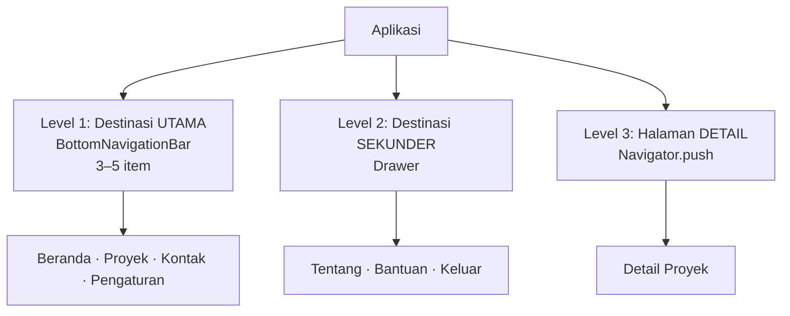
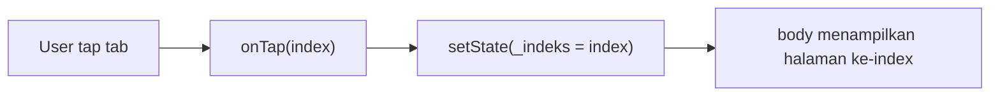
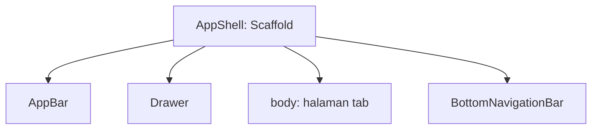
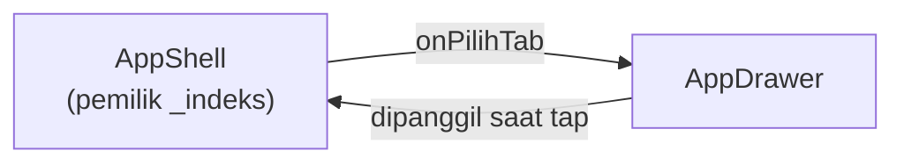
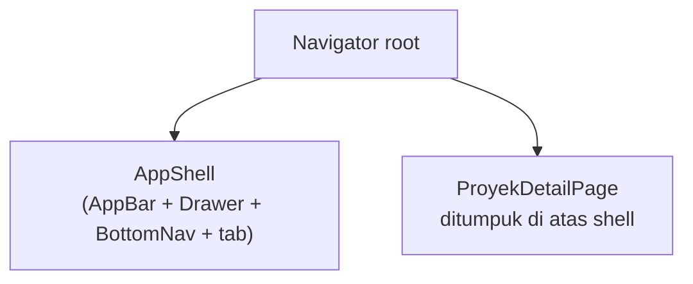
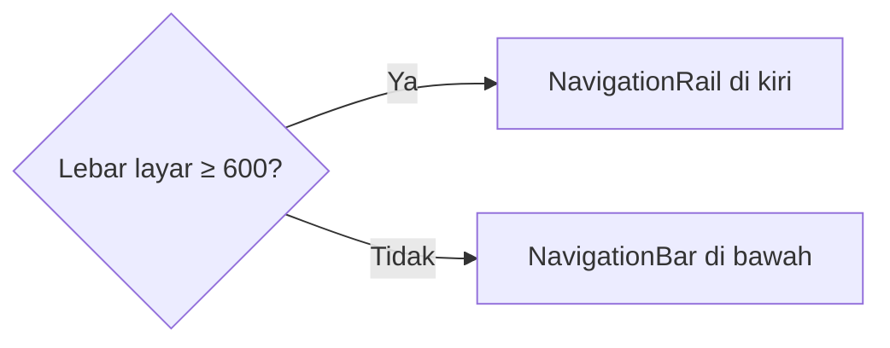

# Modul 9
## Struktur Navigasi
Drawer · BottomNavigationBar · App Shell

<div class="mt-8 opacity-70">
Pemrograman Mobile — Flutter & Dart<br>
2 pertemuan × 4 jam · Studi kasus: Kartu Profil Digital
</div>

---

# 🎯 Tujuan Pembelajaran

Setelah modul ini, kamu mampu:

<v-clicks>

1. Menjelaskan **hierarki navigasi** dan kapan memakai Drawer, BottomNavigationBar, atau `Navigator.push`
2. Membuat **Drawer** lengkap: header, menu, dialog, snackbar
3. Membuat **BottomNavigationBar** dengan **state tab yang terjaga** (`IndexedStack`)
4. Menyusun **App Shell** sebagai kerangka aplikasi
5. Menerapkan praktik industri: `NavigationBar` M3, `PopScope`, `NavigationRail`

</v-clicks>

---

# 📦 Hasil Akhir yang Akan Kamu Buat

<div class="text-lg">

Aplikasi **Kartu Profil Digital** dengan:

- 4 tab bawah: **Beranda · Proyek · Kontak · Pengaturan**
- **Drawer**: header profil, pintasan, Tentang, Keluar
- **Halaman detail** proyek
- **Bottom bar** di HP, **Navigation Rail** di layar lebar

</div>

<div class="mt-6 text-sm opacity-70">
Prasyarat: Scaffold, ListView, StatefulWidget, setState, Navigator.push/pop (Modul 3–8)
</div>

---

# 🗓️ Alur 2 Pertemuan

<div class="grid grid-cols-2 gap-8 text-sm">
<div>

### Pertemuan 1
| Waktu | Kegiatan |
|---|---|
| 0:00 | Konsep |
| 0:30 | Lab 1 — Siapkan project |
| 0:55 | Lab 2 — Drawer |
| 1:55 | Lab 3 — BottomNavigationBar |
| 2:35 | Lab 4 — IndexedStack |
| 3:05 | Challenge |

</div>
<div>

### Pertemuan 2
| Waktu | Kegiatan |
|---|---|
| 0:00 | Review |
| 0:20 | Lab 5 — Drawer ↔ Tab |
| 0:55 | Lab 6 — Halaman detail |
| 1:45 | Lab 7 — NavigationBar M3 |
| 2:20 | Lab 8 — PopScope |
| 2:55 | Lab 9 — NavigationRail |
| 3:25 | Challenge |

</div>
</div>

---
layout: section
---

# Bagian 1
## Konsep Dasar Navigasi

---

# Peta Navigasi Aplikasi



---

# Kapan Memakai Apa?

<div class="text-sm">

| Komponen | Cocok untuk | Item | Kekurangan |
|---|---|---|---|
| **BottomNavigationBar** | Menu utama, sering dibuka | 3–5 | Tidak muat banyak menu |
| **Drawer** | Menu sekunder, akun | Banyak | Tersembunyi (kurang *discoverable*) |
| **Navigator.push** | Halaman detail, form | — | Bukan untuk pindah menu utama |

</div>

<div class="mt-4 p-3 rounded bg-blue-500 bg-opacity-10 text-sm">

💡 **Insight industri:** Instagram, Tokopedia, Gojek menaruh menu **utama di bottom bar**. Drawer untuk menu **sekunder**. Menu penting yang disembunyikan di drawer jarang dibuka pengguna.

</div>

---

# Anatomi Drawer

<v-clicks>

- Dipasang di properti `drawer` milik `Scaffold`
- Jika ada `AppBar`, ikon **☰ muncul otomatis**
- Dibuka: geser dari tepi kiri atau tap ☰
- Ditutup: `Navigator.pop(context)`
- Drawer diperlakukan seperti "halaman sementara"

</v-clicks>

<div v-click class="mt-6 p-3 rounded bg-orange-500 bg-opacity-10">

⚠️ Urutan benar saat item drawer membuka halaman: **tutup drawer dulu**, baru `Navigator.push`.

</div>

---

# Anatomi BottomNavigationBar

- Dipasang di `bottomNavigationBar` milik `Scaffold`
- Butuh `currentIndex` (tab aktif) dan `onTap`
- Pindah tab = **mengganti widget di `body`**, bukan `Navigator.push`



---

# Konsep Kunci: App Shell

**App Shell** = satu `Scaffold` induk yang memegang **AppBar, Drawer, dan BottomNavigationBar**.
Halaman tab hanya mengisi `body`.



<div class="mt-4 p-3 rounded bg-red-500 bg-opacity-10 text-sm">

⚠️ **Aturan emas:** halaman di dalam tab **tidak boleh** membuat `Scaffold` + `AppBar` sendiri, atau AppBar-mu jadi **dobel**.

</div>

---

# Struktur Project

```text
lib/
├── main.dart
├── app_shell.dart            ← Scaffold induk
├── data/
│   ├── destinasi.dart        ← daftar tab (single source of truth)
│   └── proyek_data.dart      ← model & data proyek
├── pages/
│   ├── beranda_page.dart     ├── proyek_page.dart
│   ├── proyek_detail_page.dart
│   ├── kontak_page.dart      ├── pengaturan_page.dart
│   └── tentang_page.dart
└── widgets/
    └── app_drawer.dart
```

<div class="text-sm opacity-70">Struktur rapi sejak awal adalah kebiasaan industri.</div>

---
layout: section
---

# Pertemuan 1
## Drawer & BottomNavigationBar

---

# 🧪 Lab 1 — Siapkan Project

```bash
flutter create kartu_profil_navigasi
cd kartu_profil_navigasi
```

Buat folder `data`, `pages`, `widgets` di dalam `lib/`.

Lalu buat file-file berikut (kode lengkap ada di modul):

<v-clicks>

- `data/proyek_data.dart` — model `Proyek` + `daftarProyek`
- `pages/beranda_page.dart` — kartu profil **Fakhry Firdaus**
- `pages/proyek_page.dart` — `ListView.separated`
- `pages/proyek_detail_page.dart` — halaman detail (boleh punya `Scaffold`)
- `pages/kontak_page.dart`, `pengaturan_page.dart`, `tentang_page.dart`

</v-clicks>

---

# Lab 1 — Model Proyek

<style>
pre, pre code { font-size: 12px !important; line-height: 1.4 !important; }
</style>

```dart
class Proyek {
  final String judul;
  final String deskripsi;
  final IconData ikon;

  const Proyek({
    required this.judul,
    required this.deskripsi,
    required this.ikon,
  });
}

const daftarProyek = [
  Proyek(
    judul: 'Aplikasi Absensi Kampus',
    deskripsi: 'Presensi mahasiswa berbasis lokasi.',
    ikon: Icons.fingerprint,
  ),
  // ... tambahkan 3 proyek lain (lihat modul)
];
```

---

# Lab 1 — Halaman Beranda

<style>
pre, pre code { font-size: 11px !important; line-height: 1.35 !important; }
</style>

```dart
class BerandaPage extends StatelessWidget {
  const BerandaPage({super.key});

  @override
  Widget build(BuildContext context) {
    final tema = Theme.of(context).textTheme;
    return ListView(
      padding: const EdgeInsets.all(16),
      children: [
        Card(
          child: Padding(
            padding: const EdgeInsets.all(24),
            child: Column(children: [
              const CircleAvatar(
                radius: 48,
                backgroundImage: NetworkImage(
                    'https://picsum.photos/seed/profile/300/300'),
              ),
              const SizedBox(height: 16),
              Text('Fakhry Firdaus', style: tema.headlineSmall),
              const Text('Software Engineer'),
            ]),
          ),
        ),
      ],
    );
  }
}
```

---

# Lab 1 — Pitfall Gambar

<div class="text-lg">

Gambar profil tidak muncul?

</div>

<v-clicks>

- **Android:** tambahkan izin internet di `AndroidManifest.xml` (di atas tag `<application>`)
  ```xml
  <uses-permission android:name="android.permission.INTERNET"/>
  ```
- **Chrome:** masalah **CORS** → pakai `picsum.photos` (bukan `i.pravatar.cc`)

</v-clicks>

<div v-click class="mt-6 p-3 rounded bg-green-500 bg-opacity-10">

✅ **Checkpoint Lab 1:** tidak ada error merah di VS Code (kecuali `AppShell` yang belum dibuat).

</div>

---

# 🧪 Lab 2 — Drawer: Shell Sederhana

<style>
pre, pre code { font-size: 12px !important; line-height: 1.4 !important; }
</style>

`lib/app_shell.dart`

```dart
class AppShell extends StatelessWidget {
  const AppShell({super.key});

  @override
  Widget build(BuildContext context) {
    return Scaffold(
      appBar: AppBar(title: const Text('Kartu Profil Digital')),
      drawer: const Drawer(
        child: Center(child: Text('Isi drawer')),
      ),
      body: const BerandaPage(),
    );
  }
}
```

Sambungkan di `main.dart` dengan `home: const AppShell()`, lalu `flutter run`.

👉 Perhatikan ikon **☰ muncul otomatis**.

---

# Lab 2 — Isi Drawer (1/2)

<style>
pre, pre code { font-size: 11px !important; line-height: 1.35 !important; }
</style>

`lib/widgets/app_drawer.dart` — header + navigasi

```dart
Drawer(
  child: ListView(
    padding: EdgeInsets.zero,
    children: [
      const UserAccountsDrawerHeader(
        accountName: Text('Fakhry Firdaus'),
        accountEmail: Text('fakhry@example.com'),
        currentAccountPicture: CircleAvatar(
          backgroundImage: NetworkImage(
              'https://picsum.photos/seed/profile/300/300'),
        ),
      ),
      ListTile(
        leading: const Icon(Icons.info_outline),
        title: const Text('Tentang Aplikasi'),
        onTap: () {
          Navigator.pop(context); // 1. tutup drawer
          Navigator.push(         // 2. pindah halaman
            context,
            MaterialPageRoute(builder: (_) => const TentangPage()),
          );
        },
      ),
      // ...
```

---

# Lab 2 — Isi Drawer (2/2)

<style>
pre, pre code { font-size: 11px !important; line-height: 1.35 !important; }
</style>

Aksi: **SnackBar**, **Dialog** konfirmasi

```dart
ListTile(
  leading: const Icon(Icons.share_outlined),
  title: const Text('Bagikan Profil'),
  onTap: () {
    Navigator.pop(context);
    ScaffoldMessenger.of(context).showSnackBar(
      const SnackBar(content: Text('Tautan profil disalin')),
    );
  },
),
const Divider(),
ListTile(
  leading: const Icon(Icons.logout),
  title: const Text('Keluar'),
  onTap: () {
    Navigator.pop(context);
    _konfirmasiKeluar(context); // showDialog + AlertDialog
  },
),
```

Di `app_shell.dart`: `drawer: const AppDrawer()`

---

# Lab 2 — Eksperimen Wajib

<v-clicks>

1. **Hapus** `Navigator.pop(context)` pada "Tentang Aplikasi" → tekan back dari halaman Tentang.
   *Apa yang terjadi?* (Drawer masih terbuka.) Kembalikan barisnya.
2. Buka drawer lewat kode memakai `GlobalKey`:

</v-clicks>

<div v-click>

```dart
final _scaffoldKey = GlobalKey<ScaffoldState>();
// Scaffold(key: _scaffoldKey, ...)
// onPressed: () => _scaffoldKey.currentState?.openDrawer()
```

</div>

<div v-click class="mt-3 p-3 rounded bg-orange-500 bg-opacity-10 text-sm">

⚠️ Error `Scaffold.of() called with a context that does not contain a Scaffold`?
`context` berasal dari **atas** Scaffold → pakai `Builder` atau `GlobalKey`.

</div>

---

# ✅ Checkpoint Lab 2

- [ ] Ikon ☰ muncul, drawer terbuka
- [ ] Header menampilkan foto, nama **Fakhry Firdaus**, email
- [ ] "Tentang Aplikasi" membuka halaman baru, drawer tertutup
- [ ] "Bagikan Profil" memunculkan SnackBar
- [ ] "Keluar" memunculkan dialog konfirmasi

<div class="mt-6 p-3 rounded bg-blue-500 bg-opacity-10 text-sm">

💡 **Insight industri:** di aplikasi besar, perpindahan ini dikelola router (mis. `go_router`), tetapi urutan logikanya sama: **tutup drawer dulu, baru navigasi**.

</div>

---

# 🧪 Lab 3 — Destinasi: Single Source of Truth

<style>
pre, pre code { font-size: 11px !important; line-height: 1.35 !important; }
</style>

`lib/data/destinasi.dart` — satu tempat untuk label, ikon, halaman

```dart
class Destinasi {
  final String label;
  final IconData ikon, ikonAktif;
  final Widget halaman;
  const Destinasi({required this.label, required this.ikon,
      required this.ikonAktif, required this.halaman});
}

const daftarDestinasi = [
  Destinasi(label: 'Beranda', ikon: Icons.person_outline,
      ikonAktif: Icons.person, halaman: BerandaPage()),
  Destinasi(label: 'Proyek', ikon: Icons.work_outline,
      ikonAktif: Icons.work, halaman: ProyekPage()),
  Destinasi(label: 'Kontak', ikon: Icons.contacts_outlined,
      ikonAktif: Icons.contacts, halaman: KontakPage()),
  Destinasi(label: 'Pengaturan', ikon: Icons.settings_outlined,
      ikonAktif: Icons.settings, halaman: PengaturanPage()),
];
```

---

# Lab 3 — BottomNavigationBar

<style>
pre, pre code { font-size: 11px !important; line-height: 1.35 !important; }
</style>

`AppShell` menjadi **StatefulWidget** (`int _indeks = 0;`)

```dart
Scaffold(
  appBar: AppBar(title: Text(daftarDestinasi[_indeks].label)),
  drawer: const AppDrawer(),
  body: daftarDestinasi[_indeks].halaman,
  bottomNavigationBar: BottomNavigationBar(
    currentIndex: _indeks,
    onTap: (i) => setState(() => _indeks = i),
    type: BottomNavigationBarType.fixed,
    items: [
      for (final d in daftarDestinasi)
        BottomNavigationBarItem(
          icon: Icon(d.ikon),
          activeIcon: Icon(d.ikonAktif),
          label: d.label,
        ),
    ],
  ),
)
```

---

# Lab 3 — Pitfall `type: fixed`

<div class="text-lg">

Tab **lebih dari 3** tanpa `type` → Flutter memakai mode `shifting`:

</div>

<v-clicks>

- Label tab yang tidak aktif **hilang**
- Warna bisa tampak aneh

</v-clicks>

<div v-click class="mt-4 p-3 rounded bg-green-500 bg-opacity-10">

✅ Untuk 4–5 tab, selalu set `type: BottomNavigationBarType.fixed`

</div>

<div v-click class="mt-6">

### Eksperimen
1. Hapus `type`, amati, kembalikan
2. Ubah `selectedItemColor` & `unselectedItemColor`
3. Coba `showUnselectedLabels: true`

</div>

---

# 🧪 Lab 4 — Masalah: State Tab Hilang

<div class="text-lg">

Buktikan sendiri:

</div>

<v-clicks>

1. Buka tab **Pengaturan**, nyalakan switch **Notifikasi**
2. Pindah ke **Beranda**, lalu kembali ke **Pengaturan**
3. Switch kembali **mati** ❌

</v-clicks>

<div v-click class="mt-6 p-3 rounded bg-orange-500 bg-opacity-10">

**Penyebab:** setiap pindah tab, `body` berganti widget. Widget lama dibuang (*disposed*), widget baru dibuat dari nol.

</div>

---

# Lab 4 — Solusi: `IndexedStack`

Membuat **semua halaman sekaligus**, menampilkan **satu** sesuai `index`. Halaman tersembunyi tetap hidup.

```dart
body: IndexedStack(
  index: _indeks,
  children: [for (final d in daftarDestinasi) d.halaman],
),
```

<div v-click class="mt-4">

Ulangi eksperimen tadi → switch tetap menyala ✅

</div>

---

# Lab 4 — Pahami Trade-off

<div class="text-sm">

| Pendekatan | State terjaga? | Beban memori | Cocok untuk |
|---|---|---|---|
| `halaman[_indeks]` | ❌ | Ringan | Tab sederhana tanpa state |
| `IndexedStack` | ✅ | Semua tab dibangun di awal | 3–5 tab, state ringan |
| `PageStorageKey` | Hanya posisi scroll | Ringan | Menjaga scroll list |
| `go_router` `StatefulShellRoute` | ✅ + navigator per tab | Dikelola router | Skala produksi |

</div>

<div class="mt-4 p-3 rounded bg-blue-500 bg-opacity-10 text-sm">

💡 Hati-hati: jika tiap tab memanggil API berat di `initState`, **semuanya ikut dipanggil** saat aplikasi dibuka.

</div>

---

# 🏆 Challenge Pertemuan 1

Pilih minimal **satu**.

<div class="text-sm">

### ⭐ Level 1 — Personalisasi
- Ubah warna tab aktif/tidak aktif dan ganti ikon tiap tab
- Tambah menu **"Bantuan"** di drawer yang membuka halaman baru

### ⭐⭐ Level 2 — Badge & Penanda
- Beri **badge angka** di tab Kontak: `Badge(label: Text('3'), child: Icon(...))`
- Item drawer aktif tampak terpilih: `ListTile(selected: true)`

### ⭐⭐⭐ Level 3 — Navigasi di dalam Tab
- Di tab Proyek, tambahkan `TabBar` + `TabBarView`: *Semua · Mobile · Web*
- Tambahkan properti `kategori` pada model `Proyek`
- Petunjuk: `DefaultTabController`

</div>

---

# 📝 Rangkuman Pertemuan 1

<v-clicks>

- **Drawer** → menu sekunder; `Navigator.pop` sebelum pindah halaman
- **BottomNavigationBar** → 3–5 menu utama; `type: fixed` jika tab > 3
- Pindah tab = ganti widget di `body`, **bukan** `Navigator.push`
- **IndexedStack** menjaga state tab
- Halaman tab **tanpa** `Scaffold`/`AppBar` sendiri

</v-clicks>

---
layout: section
---

# Pertemuan 2
## Struktur Navigasi Tingkat Industri

---

# 🧪 Lab 5 — Drawer ↔ Tab

**Masalah:** item drawer "Proyek Saya" harus **pindah ke tab Proyek**, tapi `_indeks` ada di `AppShell`.

**Solusi:** shell mengirim **callback** ke drawer (*lifting state up*).



---

# Lab 5 — Kodenya

<style>
pre, pre code { font-size: 12px !important; line-height: 1.4 !important; }
</style>

**AppDrawer** — terima callback, tambah item baru:

```dart
final ValueChanged<int> onPilihTab;
const AppDrawer({super.key, required this.onPilihTab});

ListTile(
  leading: const Icon(Icons.work_outline),
  title: const Text('Proyek Saya'),
  onTap: () {
    Navigator.pop(context); // tutup drawer
    onPilihTab(1);          // pindah ke tab Proyek
  },
),
```

**AppShell** — kirim callback:

```dart
void _pilihTab(int i) => setState(() => _indeks = i);
// drawer: AppDrawer(onPilihTab: _pilihTab),   ← hapus 'const'
// onTap: _pilihTab,
```

---

# Lab 5 — Checkpoint & Insight

- [ ] Dari tab mana pun, "Proyek Saya" membawa ke tab Proyek
- [ ] Bottom bar ikut menandai tab Proyek sebagai aktif

<div class="mt-6 p-3 rounded bg-blue-500 bg-opacity-10 text-sm">

💡 **Insight industri:** callback cocok untuk skala kecil. Di aplikasi besar, state navigasi dipindah ke state management (Provider/Riverpod/BLoC) atau router, supaya widget mana pun bisa memicu perpindahan tab tanpa mengoper callback berlapis. Konsepnya sama, hanya "tempat penyimpanannya" berbeda.

</div>

---

# 🧪 Lab 6 — Halaman Detail

Tap proyek di tab Proyek → detail terbuka **menutupi seluruh layar, termasuk bottom bar**.



<div class="mt-2 text-sm">

`Navigator.push` bekerja di Navigator milik `MaterialApp`, jadi halaman baru menumpuk di atas **seluruh** shell. Ini perilaku **normal dan umum**.

</div>

---

# Lab 6 — Data & Hero

<style>
pre, pre code { font-size: 12px !important; line-height: 1.4 !important; }
</style>

**Kirim data lewat konstruktor** → type-safe, error terdeteksi saat kompilasi:

```dart
ProyekDetailPage(proyek: proyek)
```

**Animasi `Hero`** (opsional) — tag yang sama di kedua halaman:

```dart
// proyek_page.dart
leading: Hero(tag: 'ikon-${proyek.judul}',
    child: CircleAvatar(child: Icon(proyek.ikon))),

// proyek_detail_page.dart
Hero(tag: 'ikon-${proyek.judul}', child: Icon(proyek.ikon, size: 64)),
```

---

# Lab 6 — Pilihan Arsitektur

<div class="text-sm">

| Kebutuhan | Solusi |
|---|---|
| Detail menutupi bottom bar *(yang baru kamu buat)* | `Navigator.push` biasa |
| Detail **tetap menampilkan** bottom bar | Navigator bersarang per tab: `go_router` `StatefulShellRoute` |

</div>

<div class="mt-4 p-3 rounded bg-blue-500 bg-opacity-10 text-sm">

💡 Instagram & Spotify mempertahankan bottom bar di alur tertentu; banyak aplikasi e-commerce menyembunyikannya di halaman detail. **Keduanya valid** — pilih berdasarkan kebutuhan pengguna, bukan karena mudah dibuat.

</div>

<div class="mt-4">

- [ ] Tap proyek membuka detail dengan data benar
- [ ] Back kembali ke tab Proyek

</div>

---

# 🧪 Lab 7 — Upgrade ke Material 3

`BottomNavigationBar` = Material 2 (masih berfungsi). Untuk M3 pakai **`NavigationBar`**.

<div class="text-sm">

| `BottomNavigationBar` (lama) | `NavigationBar` (M3) |
|---|---|
| `currentIndex` | `selectedIndex` |
| `onTap` | `onDestinationSelected` |
| `items` → `BottomNavigationBarItem` | `destinations` → `NavigationDestination` |
| `icon` + `activeIcon` | `icon` + `selectedIcon` |
| `label` | `label` |

</div>

---

# Lab 7 — Kodenya

<style>
pre, pre code { font-size: 12px !important; line-height: 1.4 !important; }
</style>

```dart
bottomNavigationBar: NavigationBar(
  selectedIndex: _indeks,
  onDestinationSelected: _pilihTab,
  destinations: [
    for (final d in daftarDestinasi)
      NavigationDestination(
        icon: Icon(d.ikon),
        selectedIcon: Icon(d.ikonAktif),
        label: d.label,
      ),
  ],
),
```

<div v-click class="mt-4 p-3 rounded bg-green-500 bg-opacity-10 text-sm">

✅ Kamu hanya mengubah **satu bagian** karena daftar destinasi ada di satu tempat. Tab aktif kini punya indikator berbentuk **pil**.

</div>

---

# 🧪 Lab 8 — Masalah Tombol Back

Di tab **Kontak**, tekan back di Android → aplikasi **langsung keluar** 😬

**Aturan yang umum di industri:**

```text
Di tab selain Beranda  → back = kembali ke Beranda
Di tab Beranda         → back = keluar aplikasi
Drawer sedang terbuka  → back = tutup drawer
```

---

# Lab 8 — `PopScope`

<style>
pre, pre code { font-size: 11px !important; line-height: 1.35 !important; }
</style>

```dart
final _scaffoldKey = GlobalKey<ScaffoldState>();

return PopScope(
  canPop: _indeks == 0, // hanya boleh keluar jika di Beranda
  onPopInvokedWithResult: (didPop, result) {
    if (didPop) return;
    if (_scaffoldKey.currentState?.isDrawerOpen ?? false) {
      _scaffoldKey.currentState?.closeDrawer();
    } else {
      _pilihTab(0);
    }
  },
  child: Scaffold(
    key: _scaffoldKey,
    // ... isi Scaffold seperti sebelumnya
  ),
);
```

<div class="text-sm mt-2">

⚠️ `WillPopScope` sudah **deprecated** → gunakan `PopScope`.

</div>

---

# Lab 8 — Uji 3 Skenario (Emulator Android)

<v-clicks>

1. Di tab Kontak → back → harus ke **Beranda**
2. Di Beranda → back → aplikasi **keluar**
3. Drawer terbuka di tab Pengaturan → back → drawer **tertutup**, tab tidak berubah

</v-clicks>

<div v-click class="mt-6 p-3 rounded bg-green-500 bg-opacity-10">

✅ Ketiganya sesuai tabel aturan back.

</div>

---

# 🧪 Lab 9 — Layout Adaptif

Di tablet/Chrome, bottom bar terasa janggal.



<div class="mt-2 text-sm">

Memakai konsep responsif dari Modul 5: `MediaQuery.sizeOf(context).width`.

</div>

---

# Lab 9 — Kodenya (Bagian `build`)

<style>
pre, pre code { font-size: 10.5px !important; line-height: 1.3 !important; }
</style>

```dart
final layarLebar = MediaQuery.sizeOf(context).width >= 600;
// ...
body: Row(children: [
  if (layarLebar)
    NavigationRail(
      selectedIndex: _indeks,
      onDestinationSelected: _pilihTab,
      labelType: NavigationRailLabelType.all,
      destinations: [
        for (final d in daftarDestinasi)
          NavigationRailDestination(icon: Icon(d.ikon),
              selectedIcon: Icon(d.ikonAktif), label: Text(d.label)),
      ],
    ),
  Expanded(child: IndexedStack(index: _indeks,
      children: [for (final d in daftarDestinasi) d.halaman])),
]),
bottomNavigationBar: layarLebar ? null : NavigationBar(/* ... Lab 7 */),
```

Versi **lengkap `app_shell.dart`** ada di modul.

---

# ✅ Checkpoint Akhir Modul

```bash
flutter run -d chrome   # perkecil & perbesar jendela browser
```

- [ ] Bottom bar di layar sempit, rail di layar lebar
- [ ] Drawer berfungsi (header, pintasan, Tentang, Bagikan, Keluar)
- [ ] Pindah tab tidak menghilangkan state
- [ ] Detail proyek terbuka & kembali dengan benar
- [ ] Tombol back sesuai aturan Lab 8

---

# 🏆 Challenge Pertemuan 2

<div class="text-sm">

### ⭐ Level 1 — Material 3 Penuh
Ganti `Drawer` dengan **`NavigationDrawer`** (cek `api.flutter.dev`).

### ⭐⭐ Level 2 — Tab Kelima
Tambah tab **Galeri** (`GridView` + `picsum.photos`) hanya dengan mengubah `destinasi.dart`. Lalu coba tab **keenam**: apa yang terjadi? Mengapa pedoman desain membatasi 3–5 tab?

### ⭐⭐⭐ Level 3 — Bottom Bar Tetap di Halaman Detail
Migrasi ke **`go_router`** dengan `StatefulShellRoute.indexedStack`:
- tiap tab punya riwayat navigasi sendiri
- bottom bar **tetap tampil** saat detail dibuka
- Bonus: tap tab aktif → kembali ke awal tab (`goBranch(index, initialLocation: true)`)

</div>

---

# 🧯 Pitfall — Cek Jika Error (1/2)

<div class="text-sm">

| Gejala | Penyebab | Solusi |
|---|---|---|
| Label tab hilang | Tab > 3 tanpa `type: fixed` | `BottomNavigationBarType.fixed` |
| Drawer masih terbuka | Lupa `Navigator.pop` | Tutup drawer dulu, baru navigasi |
| `Scaffold.of() ... does not contain a Scaffold` | `context` dari atas Scaffold | `Builder` atau `GlobalKey<ScaffoldState>` |
| State tab hilang | `body` hanya satu widget | `IndexedStack` |

</div>

---

# 🧯 Pitfall — Cek Jika Error (2/2)

<div class="text-sm">

| Gejala | Penyebab | Solusi |
|---|---|---|
| Dua AppBar bertumpuk | Halaman tab punya `Scaffold`+`AppBar` | Hapus; AppBar dikelola shell |
| Ikon ☰ tidak muncul | `leading` AppBar diganti manual | Hapus `leading` atau buat tombol sendiri |
| Gambar profil tidak muncul | Izin internet / CORS Chrome | Izin `INTERNET`; pakai `picsum.photos` |
| Warning `WillPopScope` | API lama | Ganti `PopScope` |

</div>

---

# 💡 Rangkuman Praktik Industri

<div class="text-base">

<v-clicks>

1. **Utama di bawah, sekunder di samping** — bottom bar 3–5 menu, drawer untuk sisanya
2. **Satu sumber kebenaran** — daftar destinasi dibuat sekali
3. **Shell memegang kerangka** — halaman tab tanpa `Scaffold` sendiri
4. **Jaga state tab** — `IndexedStack` (kecil), `StatefulShellRoute` (produksi)
5. **Back harus masuk akal** — `PopScope`, bukan `WillPopScope`
6. **Adaptif** — bottom bar di HP, rail di layar lebar
7. **Komponen Material 3** — `NavigationBar`, `NavigationDrawer`, `NavigationRail`
8. **Pecah file** — satu widget besar, satu file

</v-clicks>

</div>

---

# 📖 Referensi

<div class="text-sm">

- Navigation & routing — `docs.flutter.dev/ui/navigation`
- `Drawer`, `NavigationDrawer` — `api.flutter.dev/flutter/material/`
- `BottomNavigationBar`, `NavigationBar`, `NavigationRail` — `api.flutter.dev/flutter/material/`
- `IndexedStack`, `PopScope` — `api.flutter.dev/flutter/widgets/`
- Pedoman Navigation Bar — `m3.material.io/components/navigation-bar`

</div>

---
layout: center
class: text-center
---

# Selamat berkarya! 🚀

Modul berikutnya: mengelola **state** aplikasi yang lebih kompleks agar navigasi dan data bisa bekerja sama dengan rapi.
