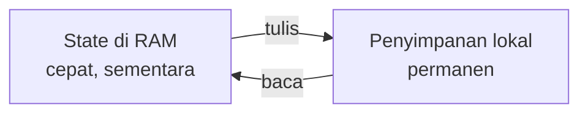
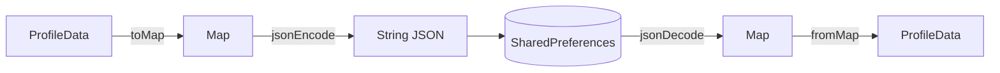
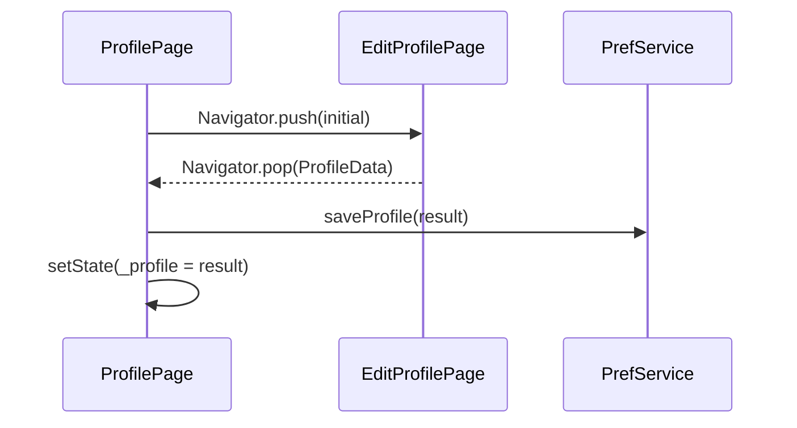
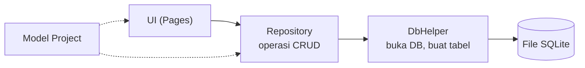
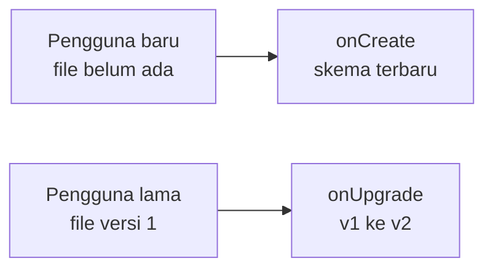
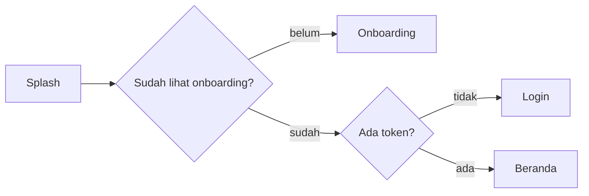
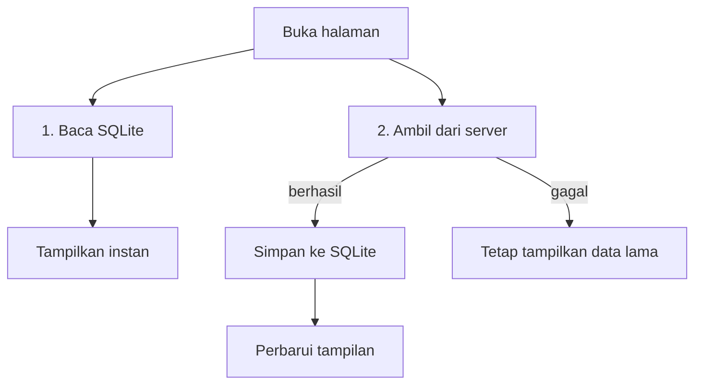
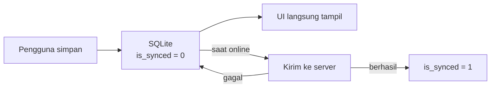
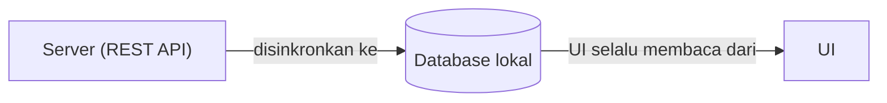

# Modul 10 — Local Storage & SQLite

Bikin Kartu Profil Digital-mu **punya ingatan** 🧠

<div class="pt-6 opacity-80">
Flutter & Dart · Studi kasus: Kartu Profil Digital · 2 × 4 jam
</div>

---
layout: center
class: text-center
---

# Tutup aplikasi → semua data hilang 😱

<div class="text-lg opacity-80 mt-4">
Edit nama, ubah tema, tambah data. Lalu aplikasi ditutup, dan semuanya kembali seperti semula.
</div>

<div class="mt-8 text-xl">
Hari ini kita perbaiki masalah ini.
</div>

---
layout: two-cols
class: text-sm
---

# Hasil akhir yang kamu bangun

| Pertemuan | Teknologi | Fitur |
|---|---|---|
| 1 | `shared_preferences` | Mode gelap, profil bisa diedit, penghitung buka aplikasi |
| 2 | `sqflite` | Daftar **Proyek Saya** dengan CRUD, favorit, jumlah proyek di profil |

<v-clicks>

- Semua data **bertahan** setelah aplikasi dimatikan
- Satu aplikasi utuh, dibangun bertahap
- Setiap lab punya **checkpoint** ✅

</v-clicks>

::right::

```text
┌─────────────────────────────┐
│ Kartu Profil Digital     ✎  │
├─────────────────────────────┤
│        ╭────╮               │
│        │ F  │               │
│        ╰────╯               │
│    Fakhry Firdaus           │
│  Software Engineer & Dosen  │
├─────────────────────────────┤
│ 🌙 Mode Gelap          [ON] │
│ 📁 Proyek Saya   2 proyek > │
│                             │
│ Kartu ini sudah dibuka 7×   │
└─────────────────────────────┘
```

---

# Tujuan pembelajaran

Setelah modul ini, kamu mampu:

<v-clicks>

- Membedakan data di memori (state) dan data yang tersimpan permanen
- Memilih penyimpanan lokal yang **tepat** untuk suatu kebutuhan
- Menyimpan dan membaca data dengan **SharedPreferences**, termasuk objek sebagai JSON
- Memahami tabel, baris, kolom, dan *primary key*
- Menulis SQL dasar dan menerapkannya lewat `sqflite`
- Membangun **CRUD** dengan arsitektur rapi: Model → Repository → UI
- Melakukan **migrasi database** tanpa menghapus data pengguna

</v-clicks>

---
class: text-sm
---

# Jadwal dua pertemuan

<div class="grid grid-cols-2 gap-8">
<div>

### Pertemuan 1 · SharedPreferences

| Waktu | Kegiatan |
|---|---|
| 30 mnt | Konsep |
| 25 mnt | Lab 1 · Persiapan |
| 30 mnt | Lab 2 · Hello SharedPreferences |
| 40 mnt | Lab 3 · Mode gelap |
| 15 mnt | Istirahat |
| 60 mnt | Lab 4 · Profil sebagai JSON |
| 15 mnt | Lab 5 · Reset & inspeksi |
| 25 mnt | Challenge & refleksi |

</div>
<div>

### Pertemuan 2 · SQLite & CRUD

| Waktu | Kegiatan |
|---|---|
| 30 mnt | Konsep database & SQL |
| 25 mnt | Lab 6 · Setup database |
| 25 mnt | Lab 7 · Model & Repository |
| 15 mnt | Istirahat |
| 45 mnt | Lab 8 · Create & Read |
| 35 mnt | Lab 9 · Update & Delete |
| 25 mnt | Lab 10 · Migrasi |
| 10 mnt | Lab 11 · Integrasi |
| 30 mnt | Challenge & refleksi |

</div>
</div>

---
layout: statement
---

# ⚠️ Pertemuan 2 jangan dijalankan di Chrome

`shared_preferences` jalan di Chrome (memakai `localStorage`).
Tetapi **`sqflite` tidak mendukung web**. Pakai **emulator Android** atau perangkat fisik.

---
layout: section
---

# Pertemuan 1

SharedPreferences

---

# Data di memori vs data tersimpan

`setState()` dan variabel hidup di **RAM**. Saat aplikasi ditutup, RAM dibersihkan.



<div class="mt-6">
Agar data bertahan, data harus <b>ditulis ke penyimpanan permanen</b> di perangkat.
</div>

---
class: text-sm
---

# Pilih penyimpanan sesuai kebutuhan

| Kebutuhan | Pilihan yang tepat |
|---|---|
| Pengaturan kecil (tema, bahasa, flag onboarding) | **SharedPreferences** |
| Data rahasia (token login, password) | `flutter_secure_storage` (terenkripsi) |
| Data terstruktur, banyak, perlu dicari/diurutkan | **SQLite** (`sqflite` / `drift`) |
| File besar (foto, PDF, audio) | File system (`path_provider`) |
| Data yang dipakai banyak perangkat/pengguna | Server (REST API / cloud) |

<div class="mt-6 text-base">
💡 Kebiasaan yang lebih penting dari menghafal tabel: tanya <b>"sekecil apa, serahasia apa, sebanyak apa?"</b>
</div>

---
layout: two-cols
class: text-sm
---

# SharedPreferences

Penyimpanan **key-value**: seperti `Map` yang tidak hilang saat aplikasi ditutup.

```text
key              value
───────────────  ───────────────────────
'is_dark_mode'   true
'open_count'     7
'profile_data'   '{"name":"Fakhry..."}'
```

**Tipe didukung:** `bool`, `int`, `double`, `String`, `List<String>`

::right::

<div class="pl-6">

### Di balik layar

- Android → `SharedPreferences` (XML)
- iOS → `NSUserDefaults`
- Web → `localStorage`

### ✅ Cocok

Data kecil dan sederhana

### ❌ Tidak cocok

Data besar, data berelasi, data yang perlu di-*query*, **data rahasia** (tersimpan sebagai teks biasa)

</div>

---
class: text-sm
---

# API yang sering dipakai

| Aksi | Kode |
|---|---|
| Ambil instance | `final prefs = await SharedPreferences.getInstance();` |
| Simpan | `await prefs.setBool('key', true);` · `setInt` · `setString` · `setDouble` · `setStringList` |
| Baca | `prefs.getBool('key')` → hasilnya **nullable** |
| Hapus satu | `await prefs.remove('key');` |
| Hapus semua | `await prefs.clear();` |
| Cek ada | `prefs.containsKey('key')` |
| Lihat semua key | `prefs.getKeys()` |

<div class="mt-4">
💡 <b>Menulis</b> itu <code>Future</code> (pakai <code>await</code>). <b>Membaca</b> itu sinkron setelah <code>getInstance()</code> selesai.
</div>

---

# Lab 1 · Persiapan project

**Tujuan:** project berjalan dengan kartu profil statis.

```bash
flutter create kartu_profil_digital
cd kartu_profil_digital
flutter pub add shared_preferences sqflite path
```

<v-click>

```text
lib/
├── main.dart
├── models/profile_data.dart
├── services/pref_service.dart
├── data/db_helper.dart · project_repository.dart
└── pages/profile_page.dart · edit_profile_page.dart
        project_list_page.dart · project_form_page.dart
```

</v-click>

<div class="mt-4 text-sm opacity-80">
Folder dipisah berdasarkan <b>tanggung jawab</b>, bukan jenis file.
</div>

---

# Lab 1 · Model `ProfileData`

```dart {2-4|6-11}
class ProfileData {
  final String name;
  final String title;
  final String bio;

  const ProfileData({required this.name, required this.title, required this.bio});

  static const defaults = ProfileData(
    name: 'Fakhry Firdaus',
    title: 'Software Engineer & Dosen',
    bio: 'Suka membangun aplikasi mobile dan berbagi ilmu.',
  );
}
```

<div class="mt-4">
✅ <b>Checkpoint 1:</b> aplikasi berjalan dan menampilkan kartu profil Fakhry Firdaus.
</div>

---

# Lab 2 · Kenapa membuat `PrefService`?

Bungkus `SharedPreferences` dalam satu kelas.

<v-clicks>

- Nama *key* ditulis **sekali** sebagai konstanta, tidak ada risiko typo `'is_dark_mod'`
- Halaman UI tidak perlu tahu **cara** data disimpan
- Ganti cara penyimpanan? Cukup ubah **satu file**

</v-clicks>

<div class="mt-6">

Kasus pertama: penghitung **"Kartu ini sudah dibuka N kali"**.

</div>

---

# Lab 2 · `PrefService`

```dart {6|9|13-15}
import 'package:shared_preferences/shared_preferences.dart';

class PrefService {
  PrefService._(this._prefs);
  final SharedPreferences _prefs;
  static const _kOpenCount = 'open_count';

  static Future<PrefService> init() async {
    final prefs = await SharedPreferences.getInstance();
    return PrefService._(prefs);
  }

  int get openCount => _prefs.getInt(_kOpenCount) ?? 0;
  Future<void> increaseOpenCount() =>
      _prefs.setInt(_kOpenCount, openCount + 1);
}
```

<div class="text-sm mt-2">
<code>?? 0</code>: pertama kali dibuka belum ada nilai, jadi <code>getInt</code> mengembalikan <code>null</code>.
</div>

---

# Lab 2 · `main()` menjadi async

```dart {2|3|4}
void main() async {
  WidgetsFlutterBinding.ensureInitialized();
  final prefs = await PrefService.init();
  await prefs.increaseOpenCount();
  runApp(MyApp(prefs: prefs));
}
```

<div class="mt-6 p-4 rounded bg-yellow-500 bg-opacity-20">
⚠️ <b>Lupa <code>WidgetsFlutterBinding.ensureInitialized()</code></b> adalah error paling umum di langkah ini. Plugin butuh Flutter engine siap sebelum dipakai.
</div>

---

# Lab 2 · Eksperimen wajib 🧪

<v-clicks>

1. Jalankan aplikasi → muncul **1 kali**
2. Tekan **Hot Restart** → muncul **2 kali**
3. **Hentikan aplikasi total**, jalankan lagi → muncul **3 kali**

</v-clicks>

<v-click>

<div class="mt-6">
Angka terus bertambah walau aplikasi dimatikan total. Itulah <b>persistensi data</b>. ✅ <b>Checkpoint 2</b>
</div>

</v-click>

<v-click>

<div class="mt-6 p-4 rounded bg-blue-500 bg-opacity-20">
🧪 <b>Pertanyaan:</b> Mengapa <code>main()</code> perlu <code>async</code>? Apa yang terjadi jika <code>await</code> pada <code>PrefService.init()</code> dihapus?
</div>

</v-click>

---

# Lab 3 · Mode gelap yang diingat

Contoh SharedPreferences yang paling umum di industri.

```dart
// PrefService
static const _kDarkMode = 'is_dark_mode';
bool get isDarkMode => _prefs.getBool(_kDarkMode) ?? false;
Future<void> setDarkMode(bool value) => _prefs.setBool(_kDarkMode, value);
```

```dart {1-2|4-7}
late final ValueNotifier<bool> _isDark =
    ValueNotifier(widget.prefs.isDarkMode);   // nilai awal dari penyimpanan

void _changeTheme(bool value) {
  _isDark.value = value;            // 1. ubah tampilan sekarang
  widget.prefs.setDarkMode(value);  // 2. simpan untuk nanti
}
```

---

# Lab 3 · Tampilkan `Switch` & uji

```dart
SwitchListTile(
  secondary: const Icon(Icons.dark_mode),
  title: const Text('Mode Gelap'),
  value: isDark,
  onChanged: onThemeChanged,
),
```

<div class="mt-4">
Uji: nyalakan Mode Gelap → <b>matikan aplikasi total</b> → jalankan lagi → langsung gelap.
</div>

<div class="mt-4 p-4 rounded bg-green-500 bg-opacity-20">
💡 <b>Kenapa dibaca sebelum <code>runApp</code>?</b> Nilai tema sudah tersedia sejak frame pertama, jadi tidak ada <b>kedipan</b> terang → gelap. Pola "muat dulu, baru tampil".
</div>

✅ **Checkpoint 3**

---

# Lab 4 · Menyimpan objek sebagai JSON

SharedPreferences hanya menerima tipe sederhana. Ubah objek menjadi **String JSON**.



---

# Lab 4 · Konversi di model

```dart {1-2|4-8|10|12-13}
Map<String, dynamic> toMap() => {'name': name, 'title': title, 'bio': bio};

factory ProfileData.fromMap(Map<String, dynamic> map) => ProfileData(
      name: map['name'] as String? ?? defaults.name,
      title: map['title'] as String? ?? defaults.title,
      bio: map['bio'] as String? ?? defaults.bio,
    );

String toJson() => jsonEncode(toMap());

factory ProfileData.fromJson(String source) =>
    ProfileData.fromMap(jsonDecode(source) as Map<String, dynamic>);
```

<div class="text-sm mt-2">Tambahkan <code>import 'dart:convert';</code> di baris paling atas.</div>

---

# Lab 4 · `PrefService`: profil

```dart {1,4-10|12-13|15}
static const _kProfile = 'profile_data';

ProfileData get profile {
  final raw = _prefs.getString(_kProfile);
  if (raw == null) return ProfileData.defaults;
  try {
    return ProfileData.fromJson(raw);
  } catch (_) {
    return ProfileData.defaults; // data rusak? jangan crash
  }
}

Future<void> saveProfile(ProfileData profile) =>
    _prefs.setString(_kProfile, profile.toJson());

Future<void> clearProfile() => _prefs.remove(_kProfile);
```

<div class="text-sm">💡 <code>try/catch</code> itu kebiasaan defensif: data lama bisa rusak atau berubah format antar versi aplikasi.</div>

---

# Lab 4 · Alur edit profil

Halaman edit **tidak menyimpan sendiri**. Ia hanya mengembalikan hasil.



<div class="mt-2 text-sm">
Halaman edit tetap sederhana dan mudah dipakai ulang. ✅ <b>Checkpoint 4:</b> hasil edit bertahan setelah aplikasi dimatikan.
</div>

---

# Lab 4 · Kode di `ProfilePage`

```dart {2-5|7-8|9-11}
Future<void> _edit() async {
  final result = await Navigator.push<ProfileData>(
    context,
    MaterialPageRoute(builder: (_) => EditProfilePage(initial: _profile)),
  );
  if (result == null) return; // pengguna menekan back

  await widget.prefs.saveProfile(result);
  if (!mounted) return;
  setState(() => _profile = result);
}
```

---
class: text-sm
---

# Lab 4 · Jebakan umum ⚠️

| Kesalahan | Akibat | Solusi |
|---|---|---|
| Lupa `await` pada `saveProfile` | Data kadang belum tertulis saat aplikasi ditutup cepat | Selalu `await` |
| Memakai `context` setelah `await` | Peringatan/error karena halaman bisa sudah tertutup | `if (!mounted) return;` |
| Mengetik ulang key di banyak tempat | Typo membuat data "hilang" | Key sebagai **konstanta** |

---

# Lab 5 · Reset & inspeksi

```dart
Future<void> _reset() async {
  await widget.prefs.clearProfile();
  if (!mounted) return;
  setState(() => _profile = widget.prefs.profile);
}
```

Untuk *debugging*, cetak semua key yang tersimpan:

```dart
debugPrint('Isi prefs: ${prefs.getKeys()}');  // open_count, is_dark_mode, profile_data
```

<div class="mt-4">

| `remove(key)` | `clear()` |
|---|---|
| Hapus **satu** data | Hapus **semua** data, termasuk tema dan penghitung |

</div>

✅ **Checkpoint 5:** tombol Reset mengembalikan profil ke bawaan.

---
class: text-sm
---

# 🏆 Challenge Pertemuan 1

| Level | Tantangan |
|---|---|
| ⭐ | Tampilkan **"Terakhir diedit: ..."** di bawah bio. Simpan waktu edit sebagai `String` ISO 8601. |
| ⭐⭐ | Buat **halaman sambutan (onboarding)** yang hanya muncul sekali. Simpan flag `has_seen_onboarding`. |
| ⭐⭐⭐ | Ganti `Switch` jadi **tiga mode** (Sistem / Terang / Gelap) dan tambahkan **pilihan warna tema**. Simpan sebagai `int` atau `String`. |

<div class="mt-6">
🎨 Bebas berkreasi: ubah warna, tambah field profil (email, lokasi). Menambah field berarti ikut memperbarui <code>toMap</code>, <code>fromMap</code>, dan form edit.
</div>

---

# Rangkuman Pertemuan 1

<v-clicks>

- State di RAM **hilang** saat aplikasi ditutup, penyimpanan lokal **bertahan**
- SharedPreferences = **key-value** untuk data kecil dan sederhana
- Bungkus dalam `PrefService`, key jadikan **konstanta**
- Objek disimpan sebagai **JSON** (`toMap`/`fromMap` + `jsonEncode`/`jsonDecode`)
- Baca data **sebelum** `runApp` agar tidak berkedip
- Jangan simpan data rahasia di sini

</v-clicks>

---
layout: section
---

# Pertemuan 2

SQLite & CRUD

---
layout: two-cols
class: text-sm
---

# Kenapa SharedPreferences tidak cukup?

Bayangkan **200 proyek**, dan kamu ingin:

<v-clicks>

- mencari judul yang mengandung "catatan"
- mengurutkan dari yang terbaru
- mengubah **satu** proyek saja

</v-clicks>

::right::

<div class="pl-6">

### Dengan key-value

Muat **seluruh** data → ubah di memori → simpan **seluruhnya** lagi.

### Dengan SQLite

Database relasional yang berjalan **di dalam aplikasimu**, berupa satu file di perangkat. Tanpa server, tanpa instalasi tambahan.

</div>

---
class: text-sm
---

# Istilah dasar database

```text
Tabel: projects
┌────┬──────────────────────┬───────────────┬──────────────┬─────────────┐
│ id │ title                │ tech_stack    │ created_at   │ is_favorite │  ← kolom
├────┼──────────────────────┼───────────────┼──────────────┼─────────────┤
│ 1  │ Kartu Profil Digital │ Flutter, Dart │ 2026-11-02.. │ 1           │  ← baris
│ 2  │ Aplikasi Catatan     │ Flutter       │ 2026-11-03.. │ 0           │
└────┴──────────────────────┴───────────────┴──────────────┴─────────────┘
  ▲ PRIMARY KEY: pengenal unik tiap baris
```

| Istilah | Arti |
|---|---|
| **Tabel** | Kumpulan data sejenis |
| **Kolom** | Satu jenis informasi |
| **Baris** | Satu data lengkap |
| **Primary Key** | Pengenal unik, biasanya `id` yang naik otomatis |

---
class: text-sm
---

# Tipe data SQLite

Hanya ada: `INTEGER`, `REAL`, `TEXT`, `BLOB`.

| Di Dart | Disimpan di SQLite sebagai |
|---|---|
| `int` | `INTEGER` |
| `double` | `REAL` |
| `String` | `TEXT` |
| `bool` | `INTEGER` (`0` = false, `1` = true) |
| `DateTime` | `TEXT` (ISO 8601) atau `INTEGER` (timestamp) |

<div class="mt-4">
Penerjemahan terjadi di <code>toMap()</code> dan <code>fromMap()</code> pada model.
</div>

---
class: text-sm
---

# CRUD, SQL, dan `sqflite`

| Operasi | Arti | SQL | Method `sqflite` |
|---|---|---|---|
| **C**reate | Tambah data | `INSERT INTO projects (...) VALUES (...)` | `db.insert(...)` |
| **R**ead | Baca data | `SELECT * FROM projects WHERE ...` | `db.query(...)` |
| **U**pdate | Ubah data | `UPDATE projects SET ... WHERE id = ?` | `db.update(...)` |
| **D**elete | Hapus data | `DELETE FROM projects WHERE id = ?` | `db.delete(...)` |

<div class="mt-6 p-4 rounded bg-red-500 bg-opacity-20">
⚠️ <b>Bahaya terbesar:</b> <code>UPDATE</code> atau <code>DELETE</code> <b>tanpa <code>WHERE</code></b> mengubah/menghapus <b>seluruh baris</b> di tabel.
</div>

---
layout: two-cols
class: text-sm
---

# Parameter `?` wajib dipahami

### ✅ Benar (aman)

```dart
db.query(
  'projects',
  where: 'title LIKE ?',
  whereArgs: ['%$keyword%'],
);
```

::right::

<div class="pl-6">

### ❌ Salah (rawan SQL injection)

```dart
db.rawQuery(
  "SELECT * FROM projects "
  "WHERE title LIKE '%$keyword%'",
);
```

</div>

<div class="mt-8">
Dengan <code>?</code>, input pengguna diperlakukan sebagai <b>data</b>, bukan sebagai perintah SQL.
</div>

---

# Arsitektur yang kita pakai



<div class="mt-6">
UI <b>tidak pernah menulis SQL</b>. UI hanya memanggil <code>repository.insert(...)</code>. Kode jadi mudah diuji dan mudah diganti, misalnya ke <code>drift</code>.
</div>

---

# Lab 6 · `DbHelper`

```dart {2-3|10|14}
class DbHelper {
  DbHelper._();
  static final DbHelper instance = DbHelper._();

  static const _dbName = 'kartu_profil.db';
  static const _dbVersion = 1;
  static const tableProjects = 'projects';

  Database? _db;
  Future<Database> get database async => _db ??= await _open();

  Future<Database> _open() async {
    final path = join(await getDatabasesPath(), _dbName);
    return openDatabase(path, version: _dbVersion, onCreate: _onCreate);
  }
}
```

<div class="text-sm">
<b>Singleton</b> (baris 2–3): satu koneksi untuk seluruh aplikasi. <b><code>??=</code></b> (baris 10): buka database hanya saat pertama dipakai.
</div>

---

# Lab 6 · Membuat tabel

```dart
Future<void> _onCreate(Database db, int version) async {
  await db.execute('''
    CREATE TABLE projects (
      id INTEGER PRIMARY KEY AUTOINCREMENT,
      title TEXT NOT NULL,
      description TEXT NOT NULL,
      tech_stack TEXT NOT NULL,
      created_at TEXT NOT NULL
    )
  ''');
}
```

<div class="mt-4 p-4 rounded bg-yellow-500 bg-opacity-20 text-sm">
⚠️ <b><code>onCreate</code> hanya jalan sekali</b>, saat file database <b>belum ada</b>. Mengubah <code>CREATE TABLE</code> setelah app pernah jalan <b>tidak berpengaruh</b>. Saat belajar: <b>uninstall aplikasi</b> dari emulator. Di produksi: <b>migrasi</b> (Lab 10).
</div>

---

# Lab 7 · Model `Project`

```dart {1-2|11-18|20-26}
class Project {
  const Project({this.id, required this.title, required this.description,
      required this.techStack, required this.createdAt});

  final int? id; // null = belum disimpan
  final String title;
  final String description;
  final String techStack;
  final DateTime createdAt;

  Map<String, Object?> toMap() => {
        if (id != null) 'id': id,
        'title': title,
        'description': description,
        'tech_stack': techStack,
        'created_at': createdAt.toIso8601String(),
      };

  factory Project.fromMap(Map<String, Object?> map) => Project(
        id: map['id'] as int?,
        title: map['title'] as String,
        description: map['description'] as String,
        techStack: map['tech_stack'] as String,
        createdAt: DateTime.parse(map['created_at'] as String),
      );
}
```

---

# Lab 7 · Repository: Create & Read

```dart {1-4|6-15}
Future<int> insert(Project project) async {
  final db = await _helper.database;
  return db.insert(_table, project.toMap()); // mengembalikan id baru
}

Future<List<Project>> getAll({String query = ''}) async {
  final db = await _helper.database;
  final rows = await db.query(
    _table,
    where: query.isEmpty ? null : 'title LIKE ?',
    whereArgs: query.isEmpty ? null : ['%$query%'],
    orderBy: 'created_at DESC', // terbaru di atas
  );
  return rows.map(Project.fromMap).toList();
}
```

<div class="text-sm">Nama kolom <code>snake_case</code> di database, field <code>camelCase</code> di Dart. Penerjemahan di <code>toMap</code>/<code>fromMap</code>.</div>

---

# Lab 7 · Repository: Update, Delete, Count

```dart {1-5|7-9|11-15}
Future<int> update(Project project) async {
  final db = await _helper.database;
  return db.update(_table, project.toMap(),
      where: 'id = ?', whereArgs: [project.id]); // ⚠️ jangan dihilangkan
}

Future<int> delete(int id) async {
  final db = await _helper.database;
  return db.delete(_table, where: 'id = ?', whereArgs: [id]); // ⚠️
}

Future<int> count() async {
  final db = await _helper.database;
  final r = await db.rawQuery('SELECT COUNT(*) FROM $_table');
  return Sqflite.firstIntValue(r) ?? 0;
}
```

---

# Lab 7 · Uji cepat lewat `main()`

Kode **sementara**, hapus setelah dicoba:

```dart
final repo = ProjectRepository();
await repo.insert(Project(
  title: 'Kartu Profil Digital',
  description: 'Aplikasi kartu profil dengan penyimpanan lokal.',
  techStack: 'Flutter, Dart',
  createdAt: DateTime.now(),
));
for (final p in await repo.getAll()) {
  debugPrint('#${p.id} ${p.title} (${p.techStack})');
}
```

<div class="text-sm mt-2">
🔍 <b>Opsional:</b> Android Studio → <b>App Inspection → Database Inspector</b> → buka <code>kartu_profil.db</code>. ✅ <b>Checkpoint 7</b>
</div>

---

# Lab 8 · Form untuk tambah **dan** edit

Satu halaman, dua mode:

```dart {1-2|4-6|8-14}
final Project? project; // null = mode tambah
bool get _isEdit => widget.project != null;

late final _title = TextEditingController(text: widget.project?.title);
late final _desc = TextEditingController(text: widget.project?.description);
late final _tech = TextEditingController(text: widget.project?.techStack);

if (_isEdit) {
  await _repo.update(project);
} else {
  await _repo.insert(project);
}
if (!mounted) return;
Navigator.pop(context, true); // true = ada perubahan
```

<div class="text-sm">Tombol dinonaktifkan selama <code>_saving</code> agar tidak terjadi data ganda.</div>

---

# Lab 8 · Daftar dengan `FutureBuilder`

Selalu tangani **tiga status**, bukan hanya "berhasil".

```dart {1-3|4-6|8-13}
if (snapshot.connectionState != ConnectionState.done) {
  return const Center(child: CircularProgressIndicator());   // loading
}
if (snapshot.hasError) {
  return Center(child: Text('Terjadi kesalahan: ${snapshot.error}')); // error
}

final items = snapshot.data ?? [];
if (items.isEmpty) {
  return const Center(child: Text('Belum ada proyek.')); // kosong
}
return ListView.builder(itemCount: items.length, itemBuilder: ...);
```

---

# Lab 8 · Uji

<v-clicks>

1. Daftar kosong → muncul "Belum ada proyek"
2. Tekan **+** → isi form → Simpan → proyek muncul
3. Kirim form kosong → muncul pesan validasi
4. **Matikan aplikasi total**, buka lagi → proyek masih ada

</v-clicks>

<v-click>

<div class="mt-6 p-4 rounded bg-green-500 bg-opacity-20">
✅ <b>Checkpoint 8:</b> kamu bisa menambah proyek dan daftar menampilkannya, bahkan setelah aplikasi dimatikan.
</div>

</v-click>

---

# Lab 9 · Update & Delete

```dart {1-2|3-8}
onTap: () => _openForm(p),            // UPDATE: form mode edit
trailing: IconButton(
  icon: const Icon(Icons.delete_outline),
  onPressed: () => _confirmDelete(p), // DELETE
),
```

```dart {1-3|4-6}
final ok = await showDialog<bool>(context: context, builder: (ctx) => AlertDialog(
  title: const Text('Hapus proyek?'),
  content: Text('"${p.title}" akan dihapus permanen.'),
  actions: [/* Batal → false, Hapus → true */],
));
if (ok != true) return;
await _repo.delete(p.id!);
```

<div class="text-sm">Form tidak perlu diubah. Mode edit sudah siap sejak Lab 8.</div>

---

# Lab 9 · Eksperimen berbahaya ☠️

<div class="p-4 rounded bg-red-500 bg-opacity-20">
Di <b>emulator saja!</b> Hapus sementara <code>where</code> dan <code>whereArgs</code> pada method <code>delete</code>, lalu hapus <b>satu</b> proyek.
</div>

<v-click>

<div class="mt-6 text-xl">
Apa yang terjadi? 😮
</div>

</v-click>

<v-click>

<div class="mt-4">
Kembalikan kodenya. Pengalaman ini membuatmu selalu ingat <code>WHERE</code>.
</div>

✅ **Checkpoint 9:** CRUD lengkap berjalan.

</v-click>

---

# Lab 10 · Migrasi database

Pengguna lama punya file versi 1. Kamu merilis fitur **favorit**. Mereka tidak boleh disuruh uninstall.



<div class="mt-4">
Solusi: <b>naikkan <code>version</code></b>, lalu tulis perubahan di <code>onUpgrade</code>.
</div>

---

# Lab 10 · Kode migrasi

```dart {1|3-7|9-16}
static const _dbVersion = 2; // naik dari 1

return openDatabase(path,
    version: _dbVersion,
    onCreate: _onCreate,
    onUpgrade: _onUpgrade, // tambahan
);

Future<void> _onUpgrade(Database db, int oldVersion, int newVersion) async {
  if (oldVersion < 2) {
    await db.execute(
      'ALTER TABLE $tableProjects '
      'ADD COLUMN is_favorite INTEGER NOT NULL DEFAULT 0',
    );
  }
}
```

<div class="p-3 rounded bg-yellow-500 bg-opacity-20 text-sm">
⚠️ Ubah <b>dua tempat</b>: <code>onCreate</code> (tambahkan kolom <code>is_favorite</code>) <b>dan</b> <code>onUpgrade</code>. Jika hanya satu, ada pengguna yang crash.
</div>

---

# Lab 10 · Model & UI favorit

```dart {1,5|3,4}
// toMap: bool → 0/1
'is_favorite': isFavorite ? 1 : 0,

// fromMap: 0/1 → bool
isFavorite: (map['is_favorite'] as int? ?? 0) == 1,
```

```dart
// Repository: favorit lebih dulu
orderBy: 'is_favorite DESC, created_at DESC',

// UI: ketuk bintang
await _repo.update(p.copyWith(isFavorite: !p.isFavorite));
_reload();
```

<div class="mt-2 text-sm">
Jalankan <b>tanpa uninstall</b>: proyek lama harus masih ada dengan bintang kosong. Error <code>no such column</code>? Cek <code>_dbVersion</code> dan <code>onUpgrade</code>. ✅ <b>Checkpoint 10</b>
</div>

---

# Lab 11 · Integrasi ke halaman profil

```dart {1-2|4-11}
final _projectRepo = ProjectRepository();
late Future<int> _countFuture = _projectRepo.count();

ListTile(
  leading: const Icon(Icons.folder_open),
  title: const Text('Proyek Saya'),
  subtitle: FutureBuilder<int>(
    future: _countFuture,
    builder: (context, s) => Text('${s.data ?? 0} proyek'),
  ),
  onTap: _openProjects, // setelah kembali: refresh _countFuture
),
```

<div class="mt-4 p-4 rounded bg-green-500 bg-opacity-20">
🎉 <b>Checkpoint 11:</b> matikan aplikasi total, buka lagi. Profil, tema, penghitung, dan semua proyek masih ada.
</div>

---
class: text-sm
---

# 🏆 Challenge Pertemuan 2

| Level | Tantangan |
|---|---|
| ⭐ | Tombol **"Hapus Semua"** di AppBar dengan dialog konfirmasi (`deleteAll()` di repository) |
| ⭐⭐ | **Kolom pencarian**. Repository sudah punya parameter `query`, tinggal buat UI-nya |
| ⭐⭐ | Hapus dengan **geser** (`Dismissible`) + SnackBar **"Urungkan"** |
| ⭐⭐⭐ | **Migrasi versi 3:** kolom `category`, dropdown di form, **filter chip** per kategori dan favorit |
| ⭐⭐⭐ | **Tabel kedua** `project_tags` dengan *foreign key*, tampilkan tag di kartu proyek (pelajari `JOIN`) |

<div class="mt-4">
Jika buntu, tuliskan: <b>data apa yang perlu disimpan, di mana disimpan, dan siapa yang mengubahnya?</b>
</div>

---
layout: section
---

# Contoh di Real Project

Pola yang sering kamu temui di aplikasi sungguhan

---
class: text-sm
---

# Peta penggunaan di aplikasi nyata

| Jenis aplikasi | SharedPreferences | Secure Storage | SQLite |
|---|---|---|---|
| **Toko online** | tema, bahasa, riwayat pencarian | token login | keranjang, wishlist, cache katalog |
| **Chat / sosial** | pengaturan notifikasi | token login | riwayat pesan, cache feed, antrean kirim |
| **Catatan / to-do** | tema, mode tampilan | — | seluruh catatan dan tugas |
| **Berita** | ukuran font, kategori favorit | token (jika ada akun) | cache artikel, bookmark |
| **Keuangan** | bahasa, flag onboarding | token, kunci enkripsi | riwayat transaksi (terenkripsi, misal SQLCipher) |

<div class="mt-4">
<b>Kecil dan tidak rahasia → SharedPreferences. Rahasia → Secure Storage. Banyak dan terstruktur → SQLite.</b>
</div>

---

# Enam pola yang akan kita bedah

| # | Pola | Teknologi |
|---|---|---|
| 1 | Sesi login, auto-login, logout | Secure Storage + Prefs + SQLite |
| 2 | Riwayat pencarian | SharedPreferences |
| 3 | Cache data server | SQLite + SharedPreferences |
| 4 | Pagination / infinite scroll | SQLite |
| 5 | Antrean tulis saat offline (outbox) | SQLite |
| 6 | Menguji repository | SQLite in-memory |

---

# 1 · Sesi login & auto-login

Layar **Splash** memutuskan tujuan saat aplikasi dibuka.



---
class: text-sm
---

# 1 · Siapa menyimpan apa?

| Data | Disimpan di | Alasan |
|---|---|---|
| Token login | **Secure Storage** | rahasia |
| Flag "sudah lihat onboarding" | SharedPreferences | tidak rahasia, kecil |
| Data milik pengguna (proyek, dll.) | SQLite | banyak, terstruktur |

```dart
class AuthStorage {
  AuthStorage({FlutterSecureStorage? storage})
      : _storage = storage ?? const FlutterSecureStorage();
  final FlutterSecureStorage _storage;

  Future<void> saveToken(String token) => _storage.write(key: 'access_token', value: token);
  Future<String?> readToken() => _storage.read(key: 'access_token');
  Future<void> clear() => _storage.delete(key: 'access_token');
}
```

---

# 1 · Splash memutuskan tujuan

```dart {2|4-11|13-14}
Future<void> _decide() async {
  final token = await widget.auth.readToken();
  if (!mounted) return;

  final WidgetBuilder target;
  if (!widget.prefs.hasSeenOnboarding) {
    target = widget.onboardingBuilder;
  } else if (token == null) {
    target = widget.loginBuilder;
  } else {
    target = widget.homeBuilder;
  }

  // Splash dibuang dari stack, Back tidak kembali ke sini
  Navigator.pushReplacement(context, MaterialPageRoute(builder: target));
}
```

---

# 1 · Logout yang benar

```dart {2|3|5-9}
Future<void> logout(BuildContext context) async {
  await auth.clear();                       // 1. hapus token
  await DbHelper.instance.clearAllTables(); // 2. hapus data pengguna lama
  if (!context.mounted) return;
  Navigator.of(context).pushAndRemoveUntil(
    MaterialPageRoute(builder: (_) => const LoginPage()),
    (route) => false,                       // 3. buang seluruh stack
  );
}
```

<div class="mt-4 p-4 rounded bg-red-500 bg-opacity-20 text-sm">
⚠️ <b>Bug nyata:</b> pengguna A logout, pengguna B login di perangkat yang sama, lalu B melihat data milik A. Penyebabnya satu: lupa membersihkan SQLite saat logout.
</div>

<div class="mt-2 text-sm">
💡 <code>db.transaction(...)</code> membungkus beberapa operasi: semuanya berhasil, atau semuanya dibatalkan.
</div>

---

# 2 · Riwayat pencarian

Daftar `String` kecil dan tidak rahasia → SharedPreferences.

```dart {4-5|7-10|12}
Future<void> addSearchHistory(String keyword, {int max = 10}) async {
  final k = keyword.trim();
  if (k.isEmpty) return;
  final list = List<String>.of(searchHistory)
    ..removeWhere((e) => e.toLowerCase() == k.toLowerCase()) // tanpa duplikat
    ..insert(0, k);                                          // terbaru di atas

  await _prefs.setStringList(_kSearchHistory, list.take(max).toList()); // dibatasi
}
```

<div class="mt-2 text-sm">
Aturan umum: <b>terbaru di atas, tanpa duplikat, dibatasi, bisa dihapus.</b> Panggil hanya saat pengguna <b>benar-benar mengirim</b> pencarian, bukan tiap ketikan.
</div>

---

# 3 · Cache-then-network

Pengguna **langsung melihat data** dari SQLite, sementara data terbaru diambil diam-diam dari server.



---

# 3 · Kontrak API + API palsu

```dart {1-3|5-17}
abstract class ArticleApi {
  Future<List<Article>> fetchArticles();
}

class FakeArticleApi implements ArticleApi {
  FakeArticleApi({this.shouldFail = false});
  final bool shouldFail; // true = simulasi tanpa internet

  @override
  Future<List<Article>> fetchArticles() async {
    await Future.delayed(const Duration(seconds: 2));
    if (shouldFail) throw Exception('Tidak ada koneksi');
    return List.generate(10, (i) =>
        Article(id: i + 1, title: 'Artikel ke-${i + 1}', body: '...'));
  }
}
```

<div class="text-sm">
💡 Repository bergantung pada <b>kontrak</b>, bukan implementasi. Di modul REST API cukup buat <code>HttpArticleApi implements ArticleApi</code>.
</div>

---

# 3 · Repository: `refresh()`

```dart {2|5-12|14}
Future<List<Article>> refresh() async {
  final fresh = await _api.fetchArticles(); // gagal? berhenti di sini
  final db = await _helper.database;

  await db.transaction((txn) async {
    final batch = txn.batch();
    batch.delete(_table); // buang cache lama
    for (final a in fresh) {
      batch.insert(_table, a.toMap());
    }
    await batch.commit(noResult: true);
  });

  return fresh;
}
```

<div class="text-sm">
<b>Server dulu</b>, baru hapus cache · <b>transaction</b>: tidak ada cache setengah jadi · <b>batch</b>: ratusan insert sekaligus.
</div>

---
class: text-sm
---

# 3 · Uji tiga skenario

| Skenario | Cara | Hasil yang diharapkan |
|---|---|---|
| Pertama kali, online | `shouldFail: false` | Spinner 2 detik, lalu 10 artikel |
| Membuka lagi, online | Buka ulang halaman | **Artikel langsung tampil**, lalu diam-diam diperbarui |
| Offline | `shouldFail: true`, stop lalu run ulang | Artikel lama tetap tampil + SnackBar "Offline" |

<div class="mt-4">

### Opsional: TTL

Simpan waktu sinkronisasi terakhir di SharedPreferences, lalu lewati refresh jika kurang dari 5 menit. `RefreshIndicator` tetap memaksa pembaruan saat pengguna menarik layar.

</div>

---

# 4 · Pagination dengan `LIMIT` dan `OFFSET`

```text
Halaman 1: LIMIT 20 OFFSET 0   → baris 1–20
Halaman 2: LIMIT 20 OFFSET 20  → baris 21–40
Halaman 3: LIMIT 20 OFFSET 40  → baris 41–60
```

```dart {3-8}
Future<List<Project>> getPage({required int limit, required int offset, String query = ''}) async {
  final db = await _helper.database;
  final rows = await db.query(_table,
    where: query.isEmpty ? null : 'title LIKE ?',
    whereArgs: query.isEmpty ? null : ['%$query%'],
    orderBy: 'is_favorite DESC, created_at DESC', // urutan HARUS stabil
    limit: limit, offset: offset);
  return rows.map(Project.fromMap).toList();
}
```

<div class="text-sm">⚠️ Tanpa <code>orderBy</code> yang konsisten, baris bisa terlewat atau muncul dua kali antar halaman.</div>

---

# 4 · Memuat halaman berikutnya

```dart {1-4|6-14}
void _onScroll() {
  final nearBottom = _scroll.position.pixels >= _scroll.position.maxScrollExtent - 200;
  if (nearBottom) _loadMore();
}

Future<void> _loadMore() async {
  if (_isLoading || !_hasMore) return; // cegah pemanggilan ganda
  setState(() => _isLoading = true);
  final page = await _repo.getPage(limit: 20, offset: _items.length);
  if (!mounted) return;
  setState(() {
    _items.addAll(page);
    _hasMore = page.length == 20; // halaman tidak penuh = data habis
    _isLoading = false;
  });
}
```

<div class="text-sm">💡 Tabel sangat besar? Tim profesional beralih ke <b>keyset pagination</b>. Cukup tahu istilahnya dulu.</div>

---

# 5 · Antrean tulis offline (outbox)

Simpan dulu di SQLite dengan penanda **"belum terkirim"**, kirim saat koneksi pulih.



---

# 5 · Kerangka `syncPending`

```dart {2|4-14|12}
Future<void> syncPending(ProjectApi api) async {
  final db = await _helper.database;
  final rows = await db.query(_table, where: 'is_synced = ?', whereArgs: [0]);
  for (final row in rows) {
    final project = Project.fromMap(row);
    try {
      await api.upload(project);
      await db.update(_table, {'is_synced': 1},
          where: 'id = ?', whereArgs: [project.id]);
    } catch (_) {
      break; // koneksi bermasalah, coba lagi nanti
    }
  }
}
```

<div class="text-sm">
<b>Idempotent</b>: aman dipanggil berulang · <b>berhenti saat gagal</b> · UI tidak menunggu server. Implementasi penuh ada di modul REST API.
</div>

---

# 6 · Menguji repository (in-memory)

Tanpa emulator, tes selesai dalam hitungan detik. `flutter pub add --dev sqflite_common_ffi`

```dart {1-3|5-8|10-15}
void main() {
  sqfliteFfiInit();
  databaseFactory = databaseFactoryFfi;

  late DbHelper helper;
  late ProjectRepository repo;
  setUp(() { helper = DbHelper.inMemory(); repo = ProjectRepository(helper: helper); });
  tearDown(() async => helper.close());

  test('insert lalu getAll mengembalikan data yang sama', () async {
    await repo.insert(_sample('Proyek A'));
    final all = await repo.getAll();
    expect(all.length, 1);
    expect(all.first.title, 'Proyek A');
  });
}
```

<div class="text-sm">Repository menerima <code>DbHelper? helper</code> sejak Lab 7 agar bisa diberi database tiruan. Rancangan rapi memudahkan pengujian.</div>

---
class: text-sm
---

# 🏆 Tugas pendalaman

| Level | Tantangan |
|---|---|
| ⭐ | **Riwayat pencarian** pada kolom pencarian proyek, lengkap dengan tombol "Hapus riwayat" |
| ⭐⭐ | **Alur Splash** dengan Onboarding dan Login sederhana, plus Logout yang membersihkan token **dan** data SQLite |
| ⭐⭐ | **Feed Artikel** + **bookmark** di tabel `bookmarks` terpisah. Kenapa tabel ini sebaiknya dipisah? |
| ⭐⭐⭐ | **Pagination** dengan pencarian aktif: *reset* saat kata kunci berubah, plus *debounce* 400 ms |
| ⭐⭐⭐ | Tes `ArticleRepository` dengan API palsu yang **gagal**: buktikan cache lama **tidak terhapus** |

---
layout: section
---

# Insight Industri

Kebiasaan tim pengembang profesional

---

# Rahasia vs bukan rahasia

**Jangan simpan token, password, atau data sensitif di SharedPreferences.** Tersimpan sebagai teks biasa dan bisa dibaca di perangkat yang di-*root*.

```dart
const storage = FlutterSecureStorage();
await storage.write(key: 'access_token', value: token);
final token = await storage.read(key: 'access_token');
```

<div class="mt-4">
Bungkus semua akses penyimpanan (<code>PrefService</code>, <code>ProjectRepository</code>). <b>Widget tidak memanggil SharedPreferences atau SQL secara langsung.</b>
</div>

---
class: text-sm
---

# Kebiasaan yang wajib dibangun

<v-clicks>

- **Selalu pakai `?`** (`where` + `whereArgs`). Jangan gabungkan string dari input pengguna.
- **Migrasi bukan opsional.** Naikkan `version` tiap perubahan skema, jangan edit migrasi lama yang sudah dirilis, uji pengguna baru, lama, dan yang melompat versi.
- **Jangan blokir UI.** Semua operasi async. Tangani *loading*, *error*, dan *kosong*.
- **Data besar?** Ambil bertahap (`limit` dan `offset`).
- **Data lokal bisa hilang** (uninstall atau Clear Data). Data penting tetap disinkronkan ke server.

</v-clicks>

---

# Pola offline-first

Database lokal menjadi **sumber kebenaran** untuk UI.



Pengguna tetap bisa memakai aplikasi tanpa internet. Sinkronisasi terjadi saat jaringan tersedia. Konsep ini akan relevan di modul **REST API**.

---
class: text-sm
---

# Alternatif dan langkah berikutnya

| Paket | Kegunaan |
|---|---|
| `drift` | Lapisan di atas SQLite dengan **query type-safe** dan migrasi terkelola |
| `flutter_secure_storage` | Penyimpanan terenkripsi untuk token dan rahasia |
| `path_provider` | Akses folder aplikasi untuk menyimpan file |
| `sqflite_common_ffi` | `sqflite` di desktop dan di *unit test* |

<div class="mt-4">
Sebelum memilih paket untuk proyek serius, cek di pub.dev: <b>tanggal pembaruan terakhir</b>, <b>likes</b>, <b>pub points</b>, dan <b>platform</b> yang didukung. Paket yang tidak dirawat adalah risiko jangka panjang.
</div>

---
class: text-xs
---

# Ringkasan jebakan yang sering terjadi

| Masalah | Penyebab | Solusi |
|---|---|---|
| `MissingPluginException` saat startup | Lupa `ensureInitialized()` atau plugin baru belum di-rebuild | Tambahkan; **stop lalu run ulang**, bukan hot reload |
| `sqflite` error di Chrome | `sqflite` tidak mendukung web | Emulator/perangkat Android |
| Perubahan `CREATE TABLE` tidak berpengaruh | `onCreate` hanya jalan sekali | Belajar: uninstall app. Produksi: migrasi |
| `no such column` | Skema DB tidak sama dengan kode | Cek `version`, `onCreate`, `onUpgrade` |
| Semua data berubah/terhapus | `update`/`delete` tanpa `where` | Selalu `where` + `whereArgs` |
| Data profil "hilang" | Salah ketik key | Konstanta untuk key |
| Warning `use_build_context_synchronously` | `context` dipakai setelah `await` | `if (!mounted) return;` |
| Data ganda | Tombol simpan ditekan berulang | Nonaktifkan tombol saat proses |

---

# Rangkuman

<v-clicks>

- **SharedPreferences:** key-value untuk data kecil (tema, flag, preferensi), objek lewat JSON
- **SQLite:** database relasional di perangkat untuk data terstruktur dan banyak
- **CRUD:** `insert`, `query`, `update`, `delete`. Selalu `where` + `whereArgs`
- **Arsitektur:** UI → Repository → DbHelper. UI tidak menulis SQL
- **Migrasi:** naikkan `version`, ubah `onCreate` **dan** `onUpgrade`
- **Real project:** sesi login, cache-then-network, pagination, outbox, dan pengujian
- **Keamanan:** data rahasia **tidak** di SharedPreferences

</v-clicks>

---

# Refleksi

Jawab dengan kalimatmu sendiri:

<v-clicks>

1. Pilihan bahasa aplikasi, token login, dan 500 catatan: masing-masing disimpan di mana, dan mengapa?
2. Mengapa `onCreate` saja tidak cukup saat menambah kolom pada aplikasi yang sudah dirilis?
3. Apa risiko menyisipkan input pengguna langsung ke string SQL, dan bagaimana cara yang benar?
4. Mengapa halaman daftar menerima `true` dari `Navigator.pop`?
5. Apa beda peran `DbHelper` dan `ProjectRepository`?
6. Pada cache-then-network, mengapa cache lama dihapus **setelah** data server berhasil diterima?
7. Apa yang harus dibersihkan saat logout, dan apa akibatnya jika terlewat?

</v-clicks>

---
class: text-sm
---

# Referensi

- `shared_preferences` · https://pub.dev/packages/shared_preferences
- `sqflite` · https://pub.dev/packages/sqflite
- `path` · https://pub.dev/packages/path
- `flutter_secure_storage` · https://pub.dev/packages/flutter_secure_storage
- `drift` · https://pub.dev/packages/drift
- Sintaks SQL SQLite · https://www.sqlite.org/lang.html
- Dokumentasi Flutter · https://docs.flutter.dev
- Dokumentasi Dart · https://dart.dev

---
layout: end
---

# Selamat berkarya! 🚀

Aplikasimu sudah tidak "pelupa" lagi.
Berikutnya: menghubungkan data lokal dengan server lewat **REST API**.
